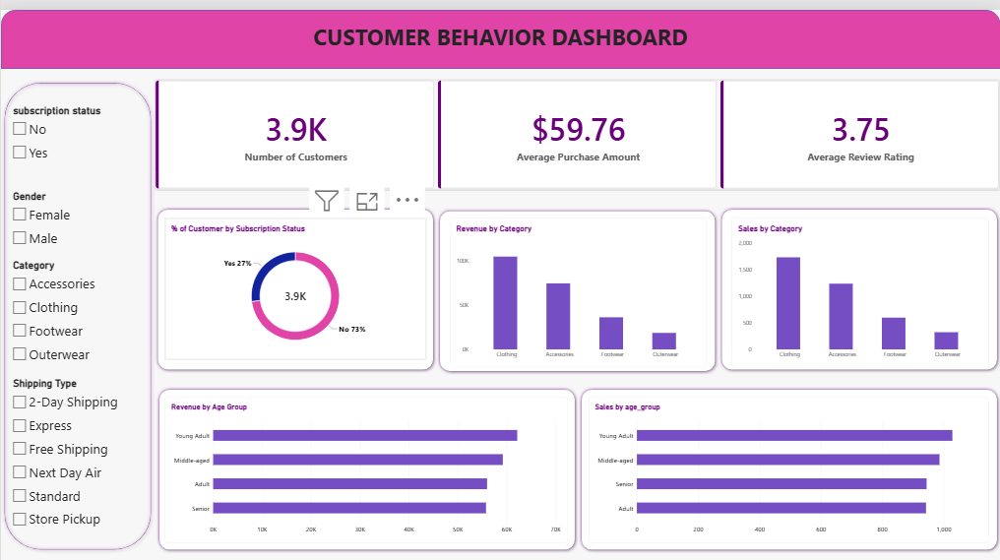

Customer Shopping Behavior Analysis

# Customer Shopping Behavior Analysis

An end-to-end data analytics project using SQL, Python, and Power BI to analyze customer shopping patterns and generate actionable business insights.

---

Project Overview

Customer shopping behavior analysis helps businesses understand purchasing preferences, spending patterns, customer segments, and product performance.

This project explores customer shopping data using PostgreSQL, Python, and Power BI to uncover meaningful patterns and support data-driven business decisions.

Business Problem

Businesses need to understand how customers shop, what influences their purchasing decisions, and how shopping behavior differs across customer groups.

This project analyzes customer shopping data to answer relevant business questions and communicate findings through SQL queries, Python analysis, and an interactive Power BI dashboard.

Project Objectives

- Analyze customer purchasing patterns and shopping preferences.
- Explore customer demographics and shopping behavior.
- Compare purchasing patterns across customer segments.
- Investigate product categories and purchase characteristics.
- Develop an interactive Power BI dashboard.
- Translate data analysis into actionable business recommendations.

Tools and Technologies

Technology| Purpose
PostgreSQL| SQL queries and business analysis
Python| Data analysis and exploratory data analysis
Pandas| Data cleaning and manipulation
Matplotlib| Data visualization
Seaborn| Statistical visualization, if used
Jupyter Notebook| Python analysis environment
Power BI| Interactive dashboard and reporting
GitHub| Project documentation and version control

Project Workflow

1. Data understanding: Reviewed the customer shopping dataset and its attributes.
2. SQL analysis: Used PostgreSQL to answer business questions and analyze shopping patterns.
3. Python analysis: Explored the dataset using Python, Pandas, and visualization libraries.
4. Dashboard development: Created a Power BI dashboard to communicate important metrics and patterns.
5. Business insights: Interpreted the results to identify opportunities for better customer understanding and business decisions.

Power BI Dashboard

The interactive Power BI dashboard presents customer shopping analysis in a visual and easy-to-understand format.

"Customer Shopping Behavior Dashboard" (customer_behavior_dashboard.png)

SQL Analysis

SQL was used to investigate customer shopping behavior and answer business-oriented questions.

SQL script: "View SQL Queries" (customer_behavior_sql_queries.sql)

Python Analysis

Python was used to explore the dataset, analyze customer behavior, and create visualizations.

Jupyter Notebook: "View Python Analysis" (customer_behavior_analysis.ipynb)

Dataset

The project uses a customer shopping behavior dataset containing customer attributes, product information, and purchase-related characteristics.

Dataset: "View Customer Shopping Dataset" (customer_shopping_behavior.csv)

Business Value

The analysis can help businesses:

- Understand customer purchasing preferences.
- Compare shopping behavior across customer groups.
- Identify opportunities for customer-focused marketing.
- Support product and sales planning.
- Make better data-driven decisions.

Key Learnings

- Writing SQL queries for business analysis.
- Working with PostgreSQL databases.
- Performing exploratory data analysis using Python.
- Manipulating data with Pandas.
- Communicating findings through visualizations.
- Designing interactive Power BI dashboards.
- Documenting an end-to-end analytics project on GitHub.

Project Files

File| Description
"customer_behavior_sql_queries.sql"| SQL analysis and business queries
"customer_behavior_analysis.ipynb"| Python analysis notebook
"customer_shopping_behavior.csv"| Project dataset
"Customer_Behavior.pbix"| Power BI dashboard
"Business Problem Document.pdf"| Business problem documentation
"Customer_Shopping_Behavior_Insight.pdf"| Project insights documentation
"customer_behavior_dashboard.png"| Dashboard preview image

Author

Prathvi Naik

Aspiring Data Analyst

Skills: SQL | Python | Excel | Power BI | Data Analysis

- LinkedIn: "Connect with me" (https://www.linkedin.com/in/prathvi-naik-967377397/)

---

Thank you for visiting my project! Feedback and suggestions are welcome.
